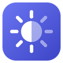
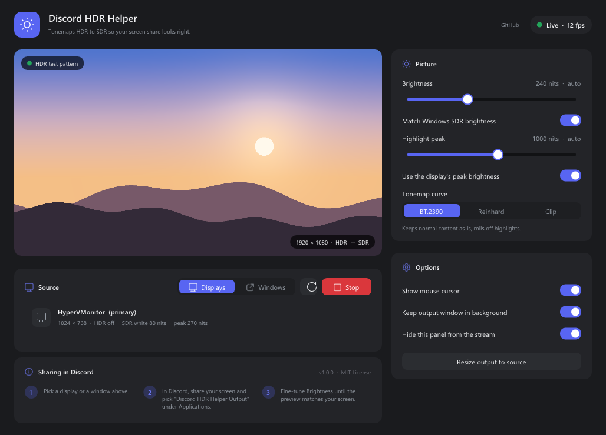

<p align="center">
  
</p>

<h1 align="center">Discord HDR Helper</h1>

<p align="center">
  Stream your HDR screen to Discord without the blinding, washed-out picture.
</p>

<p align="center">
  
</p>

When Windows HDR is on, Discord's screen share reads your desktop as if it were
plain SDR. Viewers see an image that is far too bright with faded colors.

Discord HDR Helper sits in between. It captures your display or a game window
in full HDR precision, **tonemaps it to SDR on the GPU**, and shows the result
in a clean output window. You share that window in Discord, and viewers see
your screen the way it's meant to look.

## Features

- **Accurate HDR → SDR tonemapping.** Uses the ITU-R BT.2390 curve. Normal
  desktop content stays as it is and bright HDR highlights roll off smoothly
  instead of clipping. Reinhard and Clip curves are also available.
- **Auto brightness.** Reads the *SDR content brightness* slider from Windows
  and the peak brightness your display reports, so it usually looks right with
  no tuning.
- **Live preview.** The control panel shows exactly what Discord will send.
- **Displays or single windows.** Capture a whole monitor or just one game or app.
- **Brings your game audio along.** Discord only sends sound from the app that
  owns a shared window, so the helper replays your game's audio (or every app's,
  minus Discord) from its own process for Discord to capture.
- **Stays out of the way.** The output window can sit behind everything else
  (Discord still captures it), and the control panel hides itself from screen
  capture so it never appears in your stream.
- **Light.** One small .exe that runs on the GPU and needs no install.

## Requirements

- Windows 10 version 2004 or newer (Windows 11 recommended, which also removes
  the yellow capture border)
- Audio passthrough requires Windows 11 or Windows build 20348 or newer;
  ordinary Windows 10 desktop releases support video only.
- A GPU with Direct3D 11 support
- Discord desktop app

## Getting started

1. Download `DiscordHDRHelper.exe` from the
   [latest release](https://github.com/10-Gauge/Discord-HDR-Helper/releases/latest)
   (or the newest successful [build](https://github.com/10-Gauge/Discord-HDR-Helper/actions/workflows/build.yml)).
2. Run it and pick a **display** or a **window** under *Source*.
3. In Discord, start a screen share, open the **Applications** tab and choose
   **Discord HDR Helper Output**. Not *Discord HDR Helper Settings*: that's the
   control panel, and sharing it gives a stream at the panel's size.
4. If the stream looks too bright or too dark, adjust **Stream brightness** on
   the *Picture* tab. The tonemapping settings are under *Advanced tonemapping*.

### Audio

Discord sends sound only from the app whose window you share. Discord HDR Helper
records the audio of the app you capture (or all apps except Discord when you
capture a display) and replays it, so Discord picks it up from the output window.
Make sure **Sound** is on in Discord's stream settings.

The replay must remain **unmuted**: Windows process loopback applies the helper's
session volume before Discord receives it. Earlier versions set this volume to
zero in Automatic mode, which could also leave explicitly selected devices silent.

By default the replay uses your normal output device, so you may hear the audio
twice. In the **Audio** tab, choose an output you don't listen to, such as unused
monitor speakers or the playback endpoint of a virtual audio cable. Keep the
helper unmuted in Windows Volume Mixer. If needed, silence spare speakers using
their physical controls rather than muting the helper's audio session.

If there is still no sound:

- Share **Discord HDR Helper Output** from Discord's **Applications** tab and
  enable **Sound**.
- Play sound in the source app and check the helper's Audio meter. It measures
  captured audio; it does not confirm that Discord or viewers receive it.
- If the meter stays at zero, try **All apps** (some apps play sound from a
  separate process). The source list reports silence, missing data, or the
  failing Windows operation and error code. Failed captures retry automatically.
- If the meter moves but viewers hear nothing, check the playback device and
  the helper's Windows mixer volume, then restart the Discord screen share.

### Tips

- **Capture a window, not a display, when you can.** If you capture the display
  that the output window is on and nothing covers the output window, it
  captures itself (a "hall of mirrors"). Leaving *Keep output window in
  background* on prevents this in normal use.
- **Games must be borderless or windowed.** Windows can't capture a game in
  exclusive fullscreen.
- **The output window is always the source's exact size.** Discord records a
  window at its size on screen, so a smaller output window means a blurrier,
  jagged stream. The window can be larger than your screen; it stays behind
  your other windows.
- **Turn off Auto HDR** (Windows Settings > System > Display > HDR) unless you
  need it. It turns SDR games into HDR, which Discord streams too bright.
- **Keep the output window on your HDR display.** Discord streams windows on
  an SDR monitor too dark when an HDR monitor is also connected.
- **Don't minimize the output window.** Discord can't capture minimized windows,
  so the output window has no minimize button. It stays behind your other
  windows instead.
- Settings are saved to `%APPDATA%\DiscordHDRHelper\settings.ini`.

## How it works

```
Display or window ──► Windows.Graphics.Capture (FP16 scRGB)
                  ──► GPU tonemap (BT.2390 on max(R,G,B), normalized to SDR white)
                  ──► 8-bit sRGB output window ──► Discord screen share
```

Windows describes HDR desktop content as *scRGB*: linear light where 1.0 equals
80 nits. SDR content sits at the user's SDR white level (often 200–300 nits)
and HDR highlights can reach 1,000 nits or more. The shader turns each pixel
into nits, compresses everything above the SDR white level into the SDR range
with the BT.2390 roll-off, scales color by the brightest channel's ratio so
hues hold, and writes the result through an sRGB render target.

## Building from source

You need Visual Studio 2022 or newer with the *Desktop development with C++* workload
(it includes CMake and the Windows SDK with C++/WinRT).

```powershell
cmake -S . -B build -A x64
cmake --build build --config Release
```

The executable is written to `build\Release\DiscordHDRHelper.exe`. Dear ImGui is
downloaded by CMake during configuration.

For the optional Windows audio test and Discord verification steps, see
[Audio passthrough fix and testing](docs/audio-fix.md).

## License

[MIT](LICENSE)
